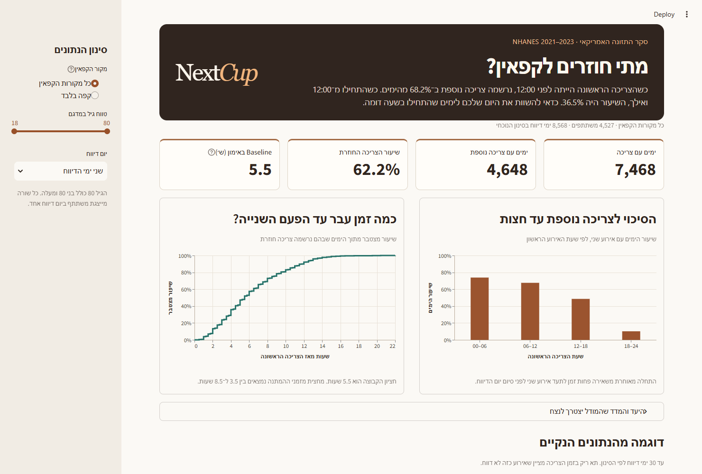

# NextCup · מתי חוזרים לקפאין?

**M2 | דשבורד תיאורי ב־Streamlit** · אוניברסיטת אריאל

כשהצריכה הראשונה של קפאין הייתה לפני הצהריים, ב־68.2% מימי הדיווח נרשמה צריכה נוספת עד חצות. כשהתחילו בצהריים או אחריהם, השיעור היה 36.5%. הדשבורד מאפשר לסטודנט או לעובד להשוות את היום שלו לקבוצת דיווחים לפי גיל ולבדוק איך התמונה משתנה כשמסתכלים על קפה בלבד.



## הפעלה

נבדק ב־Windows עם Python 3.12 ו־3.13. קובץ הנתונים הנקי כלול בריפו. אלה הפקודות מתיקיית הפרויקט בטרמינל של VS Code או ב־PowerShell, במחשב עם Python ב־PATH.

```powershell
python -m venv .venv
.\.venv\Scripts\python.exe -m pip install -r requirements.txt
.\.venv\Scripts\streamlit.exe run app.py
```

בסביבה וירטואלית פעילה הפקודות הן `pip install -r requirements.txt` ואז `streamlit run app.py`. הדפדפן מציג את הכתובת המקומית שהשרת מדפיס. לפתיחת גרסת M1 המקורית מריצים `streamlit run app_m1.py`. [הגדרת הפרויקט והפיץ׳ המקורי](docs/M1.md)

## Data Card

| שדה | הגדרה |
|---|---|
| מקור | סקר NHANES של CDC/NCHS בארה״ב, אוגוסט 2021 עד אוגוסט 2023. ראיונות תזונה של 24 שעות, דמוגרפיה, שאלון שינה ושאלון עייפות. סיווג קפה לפי USDA. [קובצי הסקר](https://wwwn.cdc.gov/nchs/nhanes/search/datapage.aspx?Component=Dietary&Cycle=2021-2023) · [סיווגי USDA](https://www.ars.usda.gov/northeast-area/beltsville-md-bhnrc/beltsville-human-nutrition-research-center/food-surveys-research-group/docs/dmr-food-categories/) |
| גודל ויחידת ניתוח | [CSV נקי](data/nextcup_days.csv), 8,568 שורות × 19 עמודות. כל שורה היא משתתף ביום דיווח. 4,527 משתתפים בני 18 ומעלה, מהם 4,041 עם שני ימים תקינים ו־486 עם יום אחד. |
| אוכלוסיית הניתוח | לשם המשכיות עם מדגם הקפאין והשינה שהצוות הכין, נדרש יום ראשון אמין עם סך קפאין ידוע, ערך לשינה הרגילה בחול ותשובת עייפות בטווח 0–3. מצרפים יום שני אמין עם סך ידוע כשהוא זמין. |
| יעד מספרי (רגרסיה) | `gap_min` הוא מספר הדקות מהאירוע הראשון לשני באותו יום. התצוגה ממירה שעות לפי הצורך. בתצוגת קפה משתמשים ב־`coffee_gap_min`. כל פריט עם כמות קפאין חיובית נכלל במצב הכללי, לרבות מזון ותה. בקפה בלבד נדרשת גם קטגוריית USDA מספר 7302. |
| כיסוי היעד | ב־7,468 ימים דווח קפאין. ב־4,648 מהם נצפה אירוע שני. ב־2,820 היה מועד יחיד וב־1,100 ימים סך הקפאין היה אפס. הפער בזמן נשאר ריק בשתי הקבוצות האחרונות. |
| מגבלות | השעות מדווחות בדיעבד. חלון הדיווח מסתיים בחצות, ויש לכל היותר יומיים למשתתף. אחרי התחלה מאוחרת נותר פחות זמן לצפות באירוע נוסף. שיעורים מחושבים לפי ימי דיווח ללא משקלי הסקר, כך שאדם שדיווח פעמיים עשוי לתרום פעמיים. זהו מדגם אמריקאי עם תנאי הכללה, והכללה לסטודנטים בישראל מצריכה בדיקה נפרדת. |
| רישיון ושימוש | הנתונים עובדו מקובצי שימוש ציבורי של הממשל הפדרלי. CDC מציין שחומרי סוכנויות פדרליות הם ככלל נחלת הכלל. הקרדיט על איסוף המידע ל־CDC/NCHS ול־USDA, והעיבוד והפרשנות באחריות הצוות. [מדיניות הציטוט של NHANES](https://wwwn.cdc.gov/nchs/nhanes/NhanesCitation.aspx) |

## מה תיקנו ולמה

- **חיבור ומפתחות.** חיברנו שאלונים לפי מזהה משתתף ואת התזונה לפי מזהה ויום. מספר שורות כפולות במפתח אדם–יום הוא אפס. שלושה ימים עם סך רשמי אפס נעדרים מקובצי הפריטים ונשמרים כימי אפס. בכל 8,568 הימים סכום הקפאין בפריטים תואם לסך היומי הרשמי.
- **פריטים שנצרכו יחד.** 16,873 שורות עם קפאין חיובי הפכו ל־15,279 מועדי צריכה. איחדנו פריטים של אותו אדם באותה דקה, כך שקפה ומזון שנאכלו יחד לא יוצרים פער מלאכותי של אפס דקות. לצורך יעד הקפה בוחרים תחילה את פריטי הקפה ומחשבים מחדש את הרצף.
- **אפס וחוסרים.** נרמלנו את הייצוג המספרי הזעיר של אפס בקובצי SAS. שעת 00:00 היא שעה תקפה. קוד מובנה של סירוב או אי־ידיעה בשאלת העייפות מוצא מהמדגם. בגרסת הביניים גיל 77 היה חסר ב־96 שורות. שחזרנו אותו מהדמוגרפיה המקורית. בסקר, 80 מציין גיל 80 ומעלה. [מילון הדמוגרפיה](https://wwwn.cdc.gov/Nchs/Data/Nhanes/Public/2021/DataFiles/DEMO_L.htm)
- **חריגים.** טווח ההמתנה שנצפה הוא 5 דקות עד 22 שעות. 29 ימים נמצאים מעל סף הרבעון העליון ועוד 1.5 פעמים הטווח הבין־רבעוני. הפערים נמצאים בתוך אותו יום ומבוססים על שתי שעות מדווחות. הערך היומי הגבוה ביותר, 2,460 מ״ג, תואם לסיכום הרשמי. שמרנו ערכים אלה והשתמשנו בחציון העמיד לערכים קיצוניים.

## שלוש תובנות

| תצפית במדגם | משמעות |
|---|---|
| מתוך 6,057 ימים שהתחילו לפני 12:00, ב־4,133 הופיע אירוע נוסף (68.2%). מתוך 1,411 ימים שהתחילו מ־12:00, ב־515 הופיע אירוע נוסף (36.5%). | לשם השוואה להרגל אישי חשוב לדעת באיזו שעה התחיל היום מבחינת צריכת קפאין. חלון התצפית הקצר יותר בערב מגביל את הפירוש הסיבתי. |
| ב־4,648 הימים עם צריכה חוזרת, החציון בין האירוע הראשון לשני הוא 5.5 שעות. מחצית זמני ההמתנה המרכזיים נמצאים בין 3.5 ל־8.5 שעות. | למשתמש מועיל להציג גם טווח סביב החציון. פיזור של חמש שעות בין הרבעונים מגביל את הדיוק של תחזית אחת לכולם. |
| ב־1,039 מתוך 5,121 ימים עם קפה נרשם עוד מועד קפה (20.3%). בכלל מקורות הקפאין נרשם עוד מועד ב־4,648 מתוך 7,468 ימים (62.2%). | קפה שני וצריכת קפאין שנייה הן שאלות שונות. ההגדרה משנה גם את האירועים וגם את הימים שבמכנה. הדשבורד מאפשר לבדוק כל הגדרה בנפרד. |

## Baseline ומבחן ל־M3

התחזית הפשוטה מחזירה לכל יום עם אירוע שני את **חציון זמני ההמתנה באימון**. בחרנו בחציון משום שהוא ממזער את סכום השגיאות המוחלטות באימון. מדד ההצלחה הוא MAE, השגיאה המוחלטת הממוצעת בדקות. הפיצול קבוע לפי מזהה משתתף באמצעות SHA-256, בקירוב 80% לאימון ו־20% למבחן. כל ימי אותו משתתף משויכים לאותו צד.

| יעד | ימי אימון עם יעד | ימי מבחן עם יעד | תחזית קבועה | MAE במבחן |
|---|---:|---:|---:|---:|
| עד הצריכה השנייה של קפאין | 3,747 | 901 | 330 דקות | 179.87 דקות |
| עד צריכת הקפה השנייה | 860 | 179 | 300 דקות | 184.74 דקות |

כדי לשפר את תחזית הקפאין ב־M3, המודל יצטרך להשיג **MAE קטן מ־179.87 דקות** על אותם משתתפי מבחן. לרשות המודל ברגע האירוע הראשון עומדים גיל, יום ושעת התחלה. היעד, שעת האירוע השני, האירוע האחרון, מספר האירועים וסך הקפאין של סוף היום חושפים מידע עתידי ומוצאים מתכונות החיזוי. כוונון מודלים ייעשה בתוך קבוצת האימון. מדד הצריכה החוזרת בדשבורד משלים את הרגרסיה ומונה גם ימים שהסתיימו אחרי אירוע אחד.

## שחזור ובדיקות

```powershell
.\.venv\Scripts\python.exe data/prepare_m2.py --download
.\.venv\Scripts\python.exe -m unittest discover -s tests -v
.\.venv\Scripts\python.exe -m pip check
```

השחזור מוריד שבעה קובצי XPT רשמיים אל `data/raw/` ומייצר את ה־CSV. אם הקבצים כבר נמצאים בתיקייה, אפשר להריץ ללא `--download`. [מילון השדות, מקורות ובדיקות שחזור](docs/data-m2.md) · [מהלך הפיץ׳ בכיתה](docs/pitch.md)

## הצוות

| חבר צוות | פקולטה | תפקיד מוביל לפי חלוקת הצוות |
|---|---|---|
| נועם מצרי | הנדסת תעשייה וניהול | מוצר, הגדרת הבעיה, המשתמש וה־MVP |
| איתן אבישר | הנדסת מכונות ומכטרוניקה | תכנות, Streamlit וריפו. שותף לעיצוב הממשק ולהדגמה |
| יאיר יצחק זיו | הנדסת מכונות ומכטרוניקה | נתונים, ניקוי, דשבורד ומודל. שותף לעיצוב הממשק ולהדגמה |
